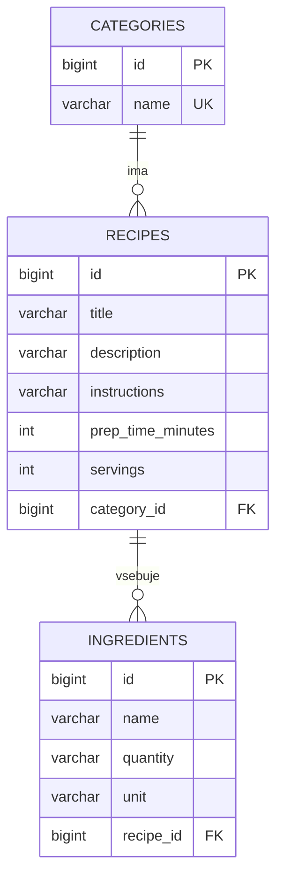

# Aplikacija z recepti

Spletna aplikacija za shranjevanje, iskanje in pregledovanje kuharskih receptov. Zaledje je REST API v Spring Bootu z MySQL bazo, obličje je React aplikacija.

## Kazalo

1. [O projektu](#1-o-projektu)
2. [Uporabljene tehnologije](#2-uporabljene-tehnologije)
3. [Struktura projekta](#3-struktura-projekta)
4. [Navodila za nameščanje in zagon](#4-navodila-za-nameščanje-in-zagon)
5. [REST vmesnik in Swagger](#5-rest-vmesnik-in-swagger)
6. [Navodila za razvijalce](#6-navodila-za-razvijalce)
7. [Standardi kodiranja](#7-standardi-kodiranja)

---

## 1. O projektu

Cilj projekta je preprosta in pregledna zbirka receptov. Uporabnik lahko:

- dodaja, ureja in briše **recepte** (naslov, opis, postopek, čas priprave, število porcij) s seznamom **sestavin**,
- recepte razvršča v **kategorije** (kategorije, ki jo uporablja kak recept, ni mogoče izbrisati),
- recepte **išče** po naslovu, opisu in imenu sestavine,
- seznam **filtrira** po kategoriji in največjem času priprave,
- seznam **razvršča** (najnovejši, naslov, čas priprave, porcije) in ga pregleduje po **straneh**.

Iskanje, filtriranje, razvrščanje in paginacija se izvajajo na strežniku (v bazi), obličje samo pošilja parametre.

Projekt je nastal pri predmetu Razvoj informacijskih sistemov (FERI). Zaledje in obličje sta ločena projekta v istem repozitoriju (monorepo) in se zaženeta vsak zase.

## 2. Uporabljene tehnologije

### Zaledje (`backend/`)

| Tehnologija | Verzija | Namen |
|---|---|---|
| Java (JDK) | 21 | programski jezik |
| Spring Boot | 4.1.1 | ogrodje (Spring Framework 7) |
| Spring Web MVC | 7.0.9 | REST kontrolerji |
| Spring Data JPA + Hibernate | Hibernate 7.4.5 | dostop do baze, `Specification` za iskanje |
| Jakarta Validation (Hibernate Validator) | 9.1.3 | validacija vhodnih podatkov |
| MySQL | 8.0 ali novejši (preizkušeno na 9.2) | podatkovna baza |
| MySQL Connector/J | 9.7.0 | gonilnik za bazo |
| springdoc-openapi | 3.1.0 | Swagger UI / OpenAPI |
| H2 | verzija iz Spring Boot BOM | baza v spominu, le za teste |
| Maven (wrapper) | 3.9.11 | gradnja (`mvnw`, namestitev Mavena ni potrebna) |

### Obličje (`frontend/`)

| Tehnologija | Verzija | Namen |
|---|---|---|
| Node.js | 18 ali novejši (preizkušeno na 24) | zagon razvojnega okolja |
| React | 18.3.1 | uporabniški vmesnik |
| Vite | 5.4.x | razvojni strežnik in gradnja |
| @vitejs/plugin-react | 4.3.x | podpora za React v Viteu |

## 3. Struktura projekta

```
.
├── README.md                     ta datoteka
├── .gitignore
├── .github/
│   └── pull_request_template.md  predloga za pull request
├── backend/                      Spring Boot aplikacija
│   ├── pom.xml                   odvisnosti in gradnja
│   ├── mvnw, mvnw.cmd, .mvn/     Maven wrapper
│   └── src/
│       ├── main/
│       │   ├── java/com/example/RisNaloga/
│       │   │   ├── RisNalogaApplication.java   vstopna točka
│       │   │   ├── Recipe, Ingredient, Category   JPA entitete
│       │   │   ├── RecipeRepository, CategoryRepository   dostop do baze
│       │   │   ├── RecipeService.java          poslovna logika (iskanje, CRUD)
│       │   │   ├── RecipeController, CategoryController   REST končne točke
│       │   │   ├── RecipeDtos.java             vhodni/izhodni objekti (DTO)
│       │   │   ├── ApiExceptionHandler.java    enotna oblika napak
│       │   │   ├── CorsConfig.java             dovoljenje za klice iz obličja
│       │   │   └── OpenApiConfig.java          nastavitve Swaggerja
│       │   └── resources/application.properties   konfiguracija (baza, Swagger)
│       └── test/                     testi (H2 baza v spominu)
└── frontend/                         React aplikacija
    ├── package.json
    ├── vite.config.js
    ├── .env.example                  primer okoljskih spremenljivk
    └── src/
        ├── main.jsx                  vstopna točka
        ├── App.jsx                   glavna komponenta, preklapljanje pogledov
        ├── api.js                    vsi klici na zaledje
        ├── filters.js                privzeti filtri, možnosti razvrščanja
        ├── styles.css
        └── components/
            ├── RecipeList.jsx        seznam z iskanjem, filtri, razvrščanjem
            ├── Pagination.jsx        gumbi za strani
            ├── RecipeDetail.jsx      prikaz enega recepta
            ├── RecipeForm.jsx        dodajanje in urejanje recepta
            └── CategoryManager.jsx   upravljanje kategorij
```

Zaledje je razdeljeno na plasti: **kontroler** (HTTP) → **servis** (logika) → **repozitorij** (baza). Entitete se ne vračajo neposredno, uporabljajo se DTO objekti.

### Podatkovni model

Tabele Hibernate ustvari samodejno ob zagonu (`ddl-auto=update`).



## 4. Navodila za nameščanje in zagon

### 4.1 Predpogoji

| Orodje | Zahteva | Preverjanje |
|---|---|---|
| Git | katera koli novejša verzija | `git --version` |
| JDK | **21** (pri višji verziji nastavi `JAVA_HOME` na JDK 21) | `java -version` |
| Node.js + npm | 18 ali novejši | `node --version` |
| MySQL | 8.0 ali novejši na `localhost:3306` (ali Docker) | `mysql --version` |

### 4.2 Prenos kode

```bash
git clone https://github.com/Mark7832/recipe-app.git
cd recipe-app
```

### 4.3 Podatkovna baza (MySQL)

Potreben je MySQL strežnik na `localhost:3306`. Bazo `recipes_db` zaledje ustvari samo. Če MySQL nimaš nameščenega, ga zaženi z Dockerjem:

```bash
docker run --name recipes-mysql -e MYSQL_ROOT_PASSWORD=geslo -p 3306:3306 -d mysql:8
```

### 4.4 Okoljske spremenljivke zaledja

| Spremenljivka | Pomen | Privzeto |
|---|---|---|
| `DB_URL` | JDBC naslov baze | `jdbc:mysql://localhost:3306/recipes_db?createDatabaseIfNotExist=true&serverTimezone=UTC` |
| `DB_USER` | uporabnik baze | `root` |
| `DB_PASSWORD` | geslo baze | `geslo` (le za lokalni razvoj, v drugih okoljih ga obvezno nastavi) |

Windows (PowerShell): `$env:DB_PASSWORD="mojegeslo"` · Linux/macOS: `export DB_PASSWORD=mojegeslo`.
V IntelliJ: Run → Edit Configurations → Environment variables.

### 4.5 Zagon zaledja

```bash
cd backend
./mvnw spring-boot:run          # Windows: mvnw.cmd spring-boot:run
```

Zaledje teče na `http://localhost:8080`.

### 4.6 Zagon obličja

V drugem terminalu:

```bash
cd frontend
npm install
npm run dev
```

Aplikacija je na `http://localhost:5173`. Če zaledje ne teče na `http://localhost:8080`, kopiraj `.env.example` v `.env` in popravi `VITE_API_URL`.

### 4.7 Testi in gradnja

```bash
cd backend && ./mvnw test          # testi uporabljajo H2, MySQL ni potreben
cd frontend && npm run build       # produkcijska gradnja v frontend/dist
```

## 5. REST vmesnik in Swagger

- Swagger UI: `http://localhost:8080/swagger-ui.html`
- OpenAPI (JSON): `http://localhost:8080/v3/api-docs`

| Operacija | Metoda | URL | Odgovor |
|---|---|---|---|
| Iskanje, filtri, razvrščanje, strani | GET | `/api/recipes?...` | 200 / 400 |
| En recept | GET | `/api/recipes/{id}` | 200 / 404 |
| Nov recept | POST | `/api/recipes` | 201 / 400 |
| Posodobitev recepta | PUT | `/api/recipes/{id}` | 200 / 400 / 404 |
| Brisanje recepta | DELETE | `/api/recipes/{id}` | 204 / 404 |
| Vse kategorije | GET | `/api/categories` | 200 |
| Ena kategorija | GET | `/api/categories/{id}` | 200 / 404 |
| Nova kategorija | POST | `/api/categories` | 201 / 409 |
| Preimenovanje kategorije | PUT | `/api/categories/{id}` | 200 / 404 / 409 |
| Brisanje kategorije | DELETE | `/api/categories/{id}` | 204 / 404 / 409 |

### Parametri za `GET /api/recipes`

Vsi so neobvezni in se poljubno kombinirajo.

| Parameter | Pomen | Privzeto |
|---|---|---|
| `q` | iskani niz: naslov, opis ali ime sestavine (brez razlike velikih/malih črk) | – |
| `categoryId` | samo recepti te kategorije | – |
| `maxPrepTime` | največji čas priprave v minutah | – |
| `sortBy` | `newest`, `title`, `prepTime`, `servings` | `newest` |
| `direction` | `asc` ali `desc` | `desc` za `newest`, sicer `asc` |
| `page` | številka strani (od 0) | `0` |
| `size` | receptov na stran (1 do 50) | `10` |

Primer: `GET /api/recipes?q=moka&categoryId=1&maxPrepTime=30&sortBy=title&direction=asc&page=0&size=6`

Odgovor je ena stran:

```json
{
  "content": [ { "id": 1, "title": "Palačinke", "...": "..." } ],
  "page": 0,
  "size": 6,
  "totalElements": 14,
  "totalPages": 3
}
```

Napake imajo enotno obliko `{ "status": 400, "error": "Bad Request", "message": "..." }`.

Primer telesa za `POST /api/recipes`:

```json
{
  "title": "Palačinke",
  "description": "Tanke palačinke",
  "instructions": "Zmešaj sestavine in speci na vroči ponvi.",
  "prepTimeMinutes": 20,
  "servings": 4,
  "categoryId": null,
  "ingredients": [
    { "name": "moka", "quantity": "200", "unit": "g" },
    { "name": "mleko", "quantity": "5", "unit": "dl" }
  ]
}
```

## 6. Navodila za razvijalce

### Način dela z repozitorijem

Uporabljamo razvoj po vejah (*feature-based*):

- Veja `main` je vedno delujoča. Neposredno vanjo ne pišemo.
- Vsaka nova funkcionalnost ali popravek dobi svojo vejo iz `main`.
- Spremembe se v `main` združijo prek **pull requesta** po pregledu kode.

Poimenovanje vej:

| Predpona | Uporaba | Primer |
|---|---|---|
| `feature/` | nova funkcionalnost | `feature/iskanje-receptov` |
| `fix/` | popravek napake | `fix/napacna-paginacija` |
| `docs/` | dokumentacija | `docs/readme` |
| `refactor/` | preurejanje brez spremembe delovanja | `refactor/recipe-service` |

### Potek dela

```bash
git checkout main && git pull                 # posodobi main
git checkout -b feature/moja-funkcionalnost   # nova veja
# ... delo, nato:
git add <datoteke>
git commit -m "feat: dodaj filtriranje po kategoriji"
git push -u origin feature/moja-funkcionalnost
```

Na GitHubu odpri **Pull Request** v `main`. Predloga zahteva opis sprememb, razlog in kontrolni seznam (testi, README, brez odvečnih datotek). PR naj bo majhen in naj vsebuje eno funkcionalnost ali popravek.

### Sporočila commitov

Format `tip: kratek opis v velelniku`, tipi:

`feat` (nova funkcionalnost) · `fix` (popravek) · `docs` (dokumentacija) · `refactor` · `test` · `chore` (gradnja, odvisnosti).

### Kaj ne spada v repozitorij

Gesla in skrivnosti, `.env`, `node_modules/`, `target/`, `dist/`, nastavitve IDE (`.idea/`, `.vscode/`). Vse to je v `.gitignore`.

### Pred pošiljanjem PR

- `./mvnw test` v mapi `backend` uspe,
- `npm run build` v mapi `frontend` uspe,
- aplikacija se zažene in sprememba deluje,
- po potrebi je posodobljen README.

## 7. Standardi kodiranja

### Splošno

- Jezik kode (imena razredov, metod, spremenljivk) je angleški, uporabniška sporočila in komentarji so slovenski.
- Kodiranje datotek je UTF-8.
- Brez neuporabljene kode in odvečnih uvozov. Komentar razloži *zakaj*, ne *kaj*.

### Java (zaledje)

- Zamik 4 presledki. Razredi `PascalCase`, metode in spremenljivke `camelCase`, konstante `UPPER_SNAKE_CASE`.
- Razdelitev na plasti: kontroler ne vsebuje logike, servis ne pozna HTTP, dostop do baze je samo v repozitorijih.
- Entitete se ne vračajo iz API-ja. Za vhod in izhod se uporabljajo DTO-ji (`record`).
- Vhodne podatke validiramo z Jakarta anotacijami (`@NotBlank`, `@Size`, `@Min`) in `@Valid`.
- Napake sprožamo z `ResponseStatusException`, enotno obliko odgovora ureja `ApiExceptionHandler`.
- Poizvedbe z uporabniškim vnosom: parametri (Specification, Pageable), nikoli sestavljanje SQL z nizi. Polja za razvrščanje so na beli listi.
- Vsaka REST metoda ima Swagger opis (`@Operation`, `@ApiResponse`).
- Nova poslovna logika ima test.

### REST

- URL-ji so samostalniki v množini (`/api/recipes`), metode HTTP po pomenu (GET, POST, PUT, DELETE).
- Pravilne kode: 200, 201 (ustvarjeno), 204 (brisanje), 400 (neveljaven vnos), 404, 409 (konflikt).

### JavaScript / React (obličje)

- Zamik 2 presledka, dvojni narekovaji, podpičja.
- Funkcijske komponente in kljuke (hooks). Datoteke komponent `PascalCase.jsx`, ostale `camelCase.js`.
- Vsi klici na zaledje so v `src/api.js`, komponente ne kličejo `fetch` neposredno.
- Stanje, ki ga potrebuje več komponent, živi v najbližji skupni nadrejeni komponenti.
- Dostopnost: vnosna polja imajo `aria-label` ali `label`, napake so v elementu z `role="alert"`.

### Podatkovna baza

- Imena tabel in stolpcev v `snake_case`, tabele v množini (`recipes`).
- Spremembe sheme se urejajo v entitetah. Za produkcijo bi namesto `ddl-auto=update` uporabili migracije (Flyway/Liquibase).
